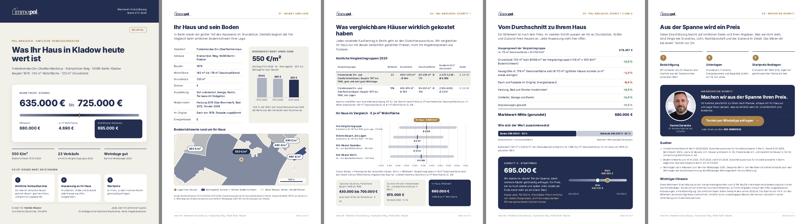

# Pal-Abgleich · Marktwert-Einschätzung für Häuser in Berlin

Ein Claude-Skill, der aus wenigen Angaben zu einem Haus eine Marktwert-Einschätzung baut. Heraus kommen ein PDF mit 5 Seiten und eine Webseite zum Teilen, beide mit Kontakt-Button zum Berater.



**Beispiel ansehen:** [PDF](beispiel/ImmoPal_Marktwert_beispiel_kladow.pdf) · Webseite als Datei in [`beispiel/webseite.html`](beispiel/webseite.html) (herunterladen und im Browser öffnen)

## Was drinsteht

- **Spanne, Mittelwert und Startpreis** auf der ersten Seite
- **Bodenrichtwert** der Adresse, live vom Geoportal Berlin, mit Verlauf seit 2024 und Karte der Nachbarzonen
- **Amtliche Vergleichsgruppen** aus dem Immobilienmarktbericht des Gutachterausschusses, passend zu Bauart, Baujahr und Wohnlage, mit Anzahl der Verkäufe
- **Jede Anpassung offen** (Grundstück, Größe, Zustand) und die Aufteilung in Boden und Gebäude
- **Startpreis** knapp unter runden Suchgrenzen der Portale
- **Kontakt-Button** mit Foto, WhatsApp mit vorausgefülltem Text und Telefon
- **Quellen und Hinweis**, dass es kein Gutachten ist

## Installation

**Claude Code** (empfohlen, braucht Internet und Chrome für das PDF)

```bash
git clone https://github.com/RHCreativevisions/pal-abgleich-marktwert ~/.claude/skills/pal-abgleich-marktwert
```

Danach in Claude Code einfach schreiben, z. B. „Mach eine Marktwert-Einschätzung für das Haus in der Musterstraße 12, 14089 Kladow, Baujahr 1979, 145 m² Wohnfläche, 720 m² Grundstück“. Claude fragt fehlende Angaben nach.

**Ohne Claude**

```bash
python3 scripts/bewertung.py objekte/beispiel_kladow.json
python3 scripts/webseite.py  objekte/beispiel_kladow.json
```

Ergebnis in `ausgabe/`. Für einen neuen Lead `objekte/beispiel_kladow.json` kopieren und ausfüllen.

## Eigene Marke

Name, Kontaktdaten, Berater, Farben und Logos stehen in [`marke.json`](marke.json), Bilder in `assets/`. Mehr steht nicht im Code.

## Datenschutz

Lead-Dateien in `objekte/` und alles in `ausgabe/` sind per `.gitignore` ausgeschlossen. Webseiten mit Namen und Adresse eines Eigentümers nur unter einem nicht erratbaren Link teilen, sie sind auf `noindex` gestellt.

## Quellen und Lizenz

- Immobilienmarktbericht Berlin 2025/2026, Gutachterausschuss für Grundstückswerte in Berlin, dl-de/zero-2-0
- Bodenrichtwerte 01.01.2024 bis 01.01.2026 und Wohnlagen zum Mietspiegel 2024, Geoportal Berlin
- Adresssuche über Nominatim/OpenStreetMap

Code unter MIT-Lizenz. Logos, Markenname und Berater-Foto gehören der ImmoPal UG und sind nicht Teil der Lizenz.

Gebaut von R&H Creativevisions für ImmoPal.
